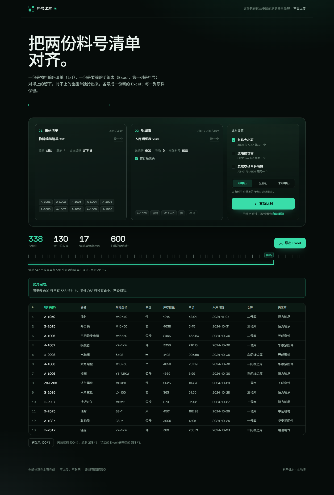
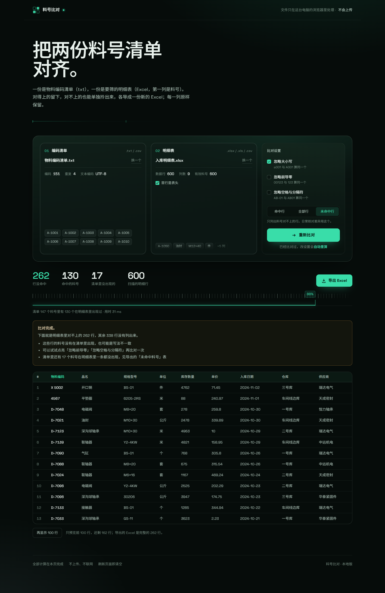

# 料号比对

一个网页，两个文件，一次比对。

把物料编码清单（txt）和明细表（Excel）丢进去，取出两边料号相同的行，导出成一个新的 Excel。**纯前端、单文件、断网可用**，文件不会离开这台电脑。



## 为什么是单文件

`index.html` 一个文件 1.9 MB，里面压着 Excel 读写库、字体、界面、全部逻辑。没有 CDN、没有外链、没有构建步骤要你跑。

拷到 U 盘、发给同事、扔进任何目录，双击就能用。断网也照常工作。

## 怎么用

双击 `index.html`，用 Edge 或 Chrome 打开。

1. txt 清单拖进左边的框（或点一下选文件）
2. Excel 明细表拖进右边的框
3. 确认「首行是表头」勾对了（一般会自动判断）
4. 点 **开始比对**
5. 点 **导出 Excel**

想先试的话，`samples/` 里有一份清单和一份 600 行的明细表，直接拖进去就能看到完整流程。

**样例文件的正确答案**：

| 设置 | 命中的行 | 命中的料号 | 清单里没出现的 |
| --- | --- | --- | --- |
| 默认（只勾「忽略大小写」） | 338 | 130 / 147 | 17 |
| 三个开关全开 | 340 | 132 / 147 | 15 |
| 三个开关全关 | 337 | 129 / 147 | 18 |

样例里特意埋了三个「写歪了」的料号，用来试开关：

- 明细第 2 行 `A-1050`，清单里写成 `a-1050` → 勾「忽略大小写」才命中
- 明细第 3 行 `X 5002`，清单里写成 `X-5002` → 勾「忽略空格与分隔符」才命中
- 明细第 4 行 `4567`（数字），清单里写成 `0004567` → 勾「忽略前导零」才命中

还有 `Z9999` 只在清单里、明细里一条都没有，导出后会进「未命中料号」那个工作表。

## 看哪一部分

右下角三档，随时切换：

| 选项 | 结果表里有什么 | 什么时候用 |
| --- | --- | --- |
| **命中行**（默认） | 只有料号对得上的行 | 要一份干净的采购/入库明细 |
| **全部行** | 明细表所有行，最后一列标 `是 / 否` | 想一眼看到全貌 |
| **未命中行** | 只有料号对不上的行 | 找差异、查漏、催供应商补料号 |



选「未命中行」时，四个数字会变成「行没命中 / 命中的料号 / 清单里没出现的 / 扫描的明细行」，提示条告诉你差在哪一类，导出文件名是 `料号比对结果_未命中行_年月日_时分.xlsx`。用样例文件时是 262 行（600 − 338）。

**换档、换开关都不用重新点按钮**——已经比对过的话，页面会按新设置立刻重算一遍。想手动触发，**重新比对** 按钮一直都在。

## 三个开关

| 开关 | 作用 | 什么时候用 |
| --- | --- | --- |
| 忽略大小写 | `a001` 和 `A001` 算同一个 | 料号大小写不统一 |
| 忽略前导零 | `00123` 和 `123` 算同一个 | 一处存成文本、一处存成数字 |
| 忽略空格与分隔符 | `AB-01`、`AB 01`、`AB01` 都算同一个 | 有人习惯加横杠或空格 |

默认只勾第一个。比对结果是 0 行时，页面会直接提示先试这几个开关，不用猜。

## 导出的表格

| 工作表 | 内容 |
| --- | --- |
| 比对结果 | 按你选的范围：命中的行 / 全部行 / 未命中的行。前面加一列「序号」，原表每一列原样保留，表头冻结、带筛选、隔行浅色 |
| 未命中料号 | 清单里有、但明细表里一行都没出现的料号 |
| 比对说明 | 这次用了哪个清单、哪个表、开了哪些选项、命中多少 |

日期列会按 Excel 的原始数字格式还原，不会因为时区差一天。

## 边界与口径

- 清单里有重复料号会自动去重，页面上显示重复了几条
- txt 编码自动识别：UTF-8（含 BOM）、UTF-16、GBK / GB18030
- 以 `#` 或 `//` 开头的行按注释跳过
- 明细表第一列是空单元格的行不参与命中，但仍计入「扫描的明细行」
- 工作簿有多个工作表时会列出来让你选
- 5 万条清单 × 12 万行明细，比对约 0.1 秒；同样量导出「全部行」约 8 秒、6.6 MB

## 关于隐私

没有任何上传。文件用 `FileReader` 在浏览器里读，比对和生成 Excel 都在本地内存里完成，页面不发起任何网络请求。关掉页面，数据就没了。

## 导出打不开怎么办

Windows 会给「从浏览器存下来的文件」打一个来自网络的标记（`ZoneId=3`），Excel 见到它就先进保护视图。极少数机器上保护视图本身是坏的，症状是卡在「正在打开」十几秒后自己去「文档恢复」，也不报错——这不是文件坏了，用 Python 的 openpyxl 或 LibreOffice 都能正常读。

两条路：

1. **存到被 Excel 信任的目录**：文档、下载、桌面。Excel → 文件 → 选项 → 信任中心 → 信任中心设置 → 受信任位置，可以把别的目录也加进去。
2. **右键文件 → 属性 → 勾「解除锁定」→ 确定**，这份文件就能开了。

## 开发

`dev/` 里是源码和测试，日常使用不需要，删掉不影响 `index.html`。

```
dev/
  template.html      页面骨架与样式
  core.js            纯逻辑：归一化、比对、日期换算、导出
  app.js             交互层
  build.js           打包成单文件（模板 + 字体 + 两个库 + 逻辑）
  test.js            逻辑单测 ............ 99 项
  e2e.js             真实浏览器端到端 .... 79 项（CDP 驱动 Edge）
  smoke.js           产物冒烟 ........... 19 项
  solo_check.js      单文件自包含验证 ... 16 项
  stress.js          压测
  make_samples.js    重新生成 samples/
```

重新打包：

```bash
cd dev
node build.js        # → ../index.html
node test.js && node smoke.js && node e2e.js && node solo_check.js
```

需要 Node.js 18+ 和支持 CDP 的 Edge / Chrome。测试里打了 `C:\Program Files (x86)\Microsoft\Edge\Application\msedge.exe`，换机器要改。

## License

MIT
